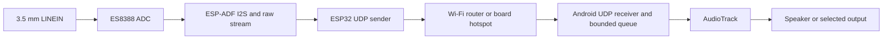

# Architecture

## Board lifecycle

The firmware reads saved router credentials from NVS on boot. If none exist, it starts the `A1S-Audio` setup hotspot. Its HTTP page is available at `audiobridge.local` through mDNS and at `192.168.4.1`. Saving the form commits the SSID and password to NVS and restarts the board. If a saved network fails after five retries, the hotspot returns so settings can be changed. GPIO22 drives the green status LED: steady on for a router connection, blinking otherwise.

The ES8388 ADC captures LINEIN through its LINE2 input at 48 kHz, 16-bit stereo. ESP-ADF's I2S reader and raw stream feed 240 sample frames (5 ms) at a time to the UDP sender. Each datagram is 976 bytes: a 16-byte header and 960 bytes of PCM. The firmware keeps at most three listener slots, learned from `JOIN` requests. It sends a separate unicast packet to every active listener. Sending is nonblocking so a slow receiver cannot hold up ADC capture.

## Android lifecycle

The user starts a foreground media playback service. The app binds its UDP socket to the phone's Wi-Fi network, broadcasts `DISCOVER AUB1`, and uses the board's `HERE` reply to learn its current IP. The same socket then sends `JOIN` and periodic `KEEP` commands. A dedicated receive thread validates and queues audio packets. A playback thread feeds their unmodified PCM to `AudioTrack` through a bounded queue. The notification provides a Stop action, which closes the socket and stops playback. The app retries discovery if the board or Wi-Fi disconnects.

## Design limits

- **Transport:** UDP keeps audio moving without retransmission stalls, but packets can be lost. The app fills short gaps with silence. This is a tradeoff between latency and continuity; it is not a bit-perfect delivery guarantee.
- **Source fidelity:** The ADC cannot recover an overdriven input. Lower the LINEIN signal before the board when clipping occurs. The optional silence gate can mute low-level noise but may also mute very quiet music.
- **Latency:** Capture uses 5 ms packets; Android starts after a small receive queue. Router, phone audio hardware, and selected output add delay. End-to-end delay has not yet been measured.
- **Scale:** The default and menuconfig maximum is three audio listeners. Three UDP listener sockets were tested on one Wi-Fi client; three separate phone connections have not yet been validated.
- **Bluetooth:** The original ESP32 supports Classic Bluetooth A2DP but not LE Audio broadcast. This design uses Wi-Fi for standard Android app reception and multiple listeners.
